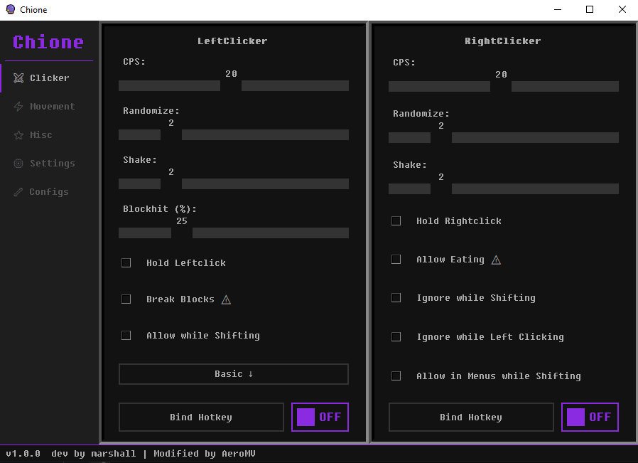
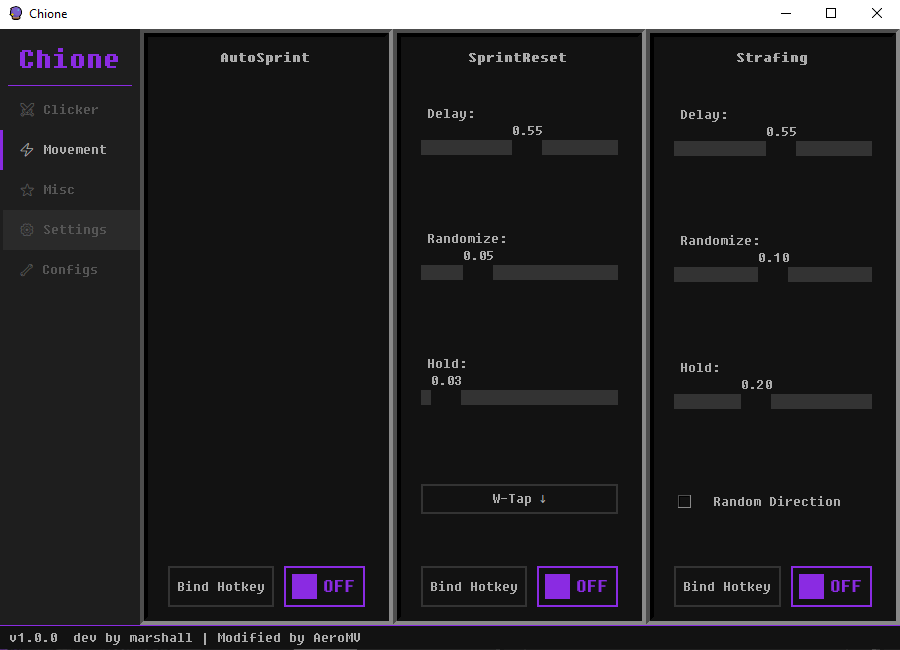

# 🔮 Chione v1.0.0

Chione is an external autoclicker and movement tool for Minecraft 1.7/1.8 PvP.

This is a modified fork of [Chione v0.1.8](https://github.com/LennardFe/Chione), originally by marshall. It includes changes to clicking behavior, movement modules, hotkeys, and configuration handling.

## Changes in v1.0.0

### Clicking

- **Fixed CPS behavior.** The clicker aims to stay closer to the configured CPS.
- **Added Right Clicker filters:**
  - `Ignore while Shifting` stops right clicking while crouching.
  - `Ignore while Left Clicking` pauses right clicking while attacking.
  - `Allow in Menus while Shifting` allows shift-clicking in chests and inventories.
- Fixed block breaking issues reported with Lunar, Badlion, and other launchers.

### Movement

- **AutoSprint:** Fixed unexpected switches between sprinting and walking.
- **SprintReset:** Added W-Tap, S-Tap, and Crouch modes for combat.
- **Strafing:** Improved A/D switching during fights while reducing interference with manual movement.

### Hotkeys and window handling

- Improved support for different keyboard layouts, including AZERTY and Arabic.
- Fixed hotkeys that could stop working after switching windows.
- Reworked window focus detection to address freezes after alt-tabbing.

### Configuration

- Added recovery for corrupted configuration files.
- Updated the default clicker settings.

## Default settings

| Setting | Default |
| --- | --- |
| CPS | `13` |
| Randomize | `0` |
| Shake | `0` |
| Hold Leftclick | `ON` |
| Allow while Shifting | `ON` |

## Screenshots

  
  

## Download

Download the Windows executable from [Releases](https://github.com/AeroMV/Chione/releases).

Chione requests administrator privileges when launched. Review the source code before running an executable you don't trust.

## Run from source

**Requirements:** Windows and Python 3.11 or newer.

Clone the repository and install the dependencies:

    git clone https://github.com/AeroMV/Chione.git
    cd Chione
    python -m venv .venv
    .venv\Scripts\activate
    python -m pip install -r requirements.txt

Start the application:

    python main.py

### Build the executable

    pyinstaller Chione.spec

The packaged files are written to `dist/`.

## Troubleshooting

- **A module is ON but does nothing / Chione does not start:** errors are written to `chione_error.log` in your user folder (`C:\Users\<you>\chione_error.log`). Please attach it when reporting a bug.
- **Chione closes right after launch:** it needs administrator rights. Accept the Windows prompt.
- **Antivirus removed the .exe:** autoclickers use keyboard/mouse hooks and are often flagged as false positives. Add an exception or run from source.

## Server rules

Some Minecraft servers prohibit autoclickers or movement tools. Check the rules of the server you play on before using Chione.

---

Modified by **AeroMV**. Based on the original work by **marshall**.
